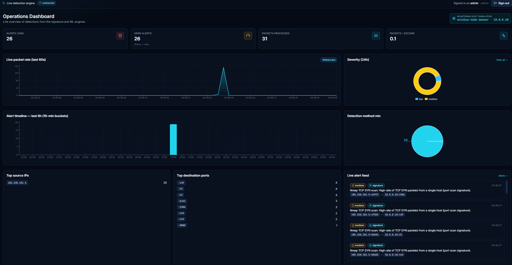
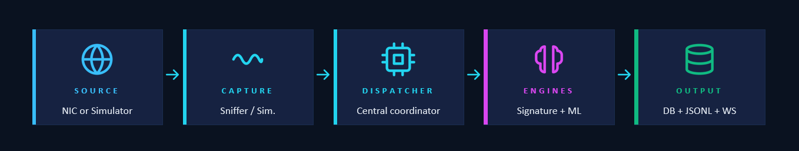

# Ovidius NIDS — Signature + ML Network Intrusion Detection System

[](https://github.com/BoraCristian/ovidius-nids/actions/workflows/ci.yml)

A **full-stack, SIEM-style network intrusion detection system** built from scratch for my
Bachelor's thesis at the Faculty of Mathematics and Computer Science, *Ovidius University of Constanța* (2026).



It combines:

- **Signature-based detection**: a Suricata/Snort-style rule engine (ports, flags, content,
  regex, sliding-window thresholds) whose rules can be edited live from the UI.
- **Machine-learning detection**: Random Forest (supervised) and Isolation Forest (unsupervised
  anomaly detection), trained in-app and scored on every packet in real time.
- **Hybrid categorisation**: an alert is tagged `signature`, `ml` or `hybrid` (both engines agree).
- **Built-in forensics**: every alert stores a snapshot of the surrounding packets, viewable in-app
  and downloadable.
- **Real-time dashboard**: WebSocket-powered live packet rate, alert feed and charts.
- **Attack Console**: one-click simulated attacks (Nmap scan, SSH brute force, ICMP flood,
  SQL injection, command injection, reverse shell) to demo detection end to end.

📄 Full thesis: [`docs/thesis/LICENTA_2026_Bora.RM.Cristian-Vasile.pdf`](docs/thesis/LICENTA_2026_Bora.RM.Cristian-Vasile.pdf)
· Slides: [`docs/presentation-beamer/Ovidius_NIDS_Beamer.pdf`](docs/presentation-beamer/Ovidius_NIDS_Beamer.pdf)

## Architecture



1. **Capture**: `engine/sniffer.py` either sniffs a real interface with Scapy or runs the
   built-in `TrafficSimulator` (default), which targets a single "defended host" (`10.0.0.10`).
2. **Dispatcher**: `engine/dispatcher.py` handles every packet: updates counters and the
   ring buffer, publishes live traffic over the bus, then asks both engines for a verdict.
3. **Engines**:
   - `engine/signatures.py` matches packets against the rules in `data/rules/default_rules.yaml`
     (protocol, IP/port, TCP flags, content, regex, *N packets in T seconds* thresholds).
   - `engine/ml_detector.py` extracts 6 features per packet (src/dst port, length, protocol,
     TCP flag mask, per-source inter-arrival time) and scores them with the active model.
     ML-only alerts need a score of at least 0.8. If a signature also matched, the alert becomes `hybrid`.
4. **Output**: alerts are written to SQLite (async SQLAlchemy), a forensic packet snapshot
   is saved, and the alert is broadcast over WebSocket to the React UI.

| Layer      | Technology                                                         |
|------------|--------------------------------------------------------------------|
| Backend    | Python 3.12, FastAPI, SQLAlchemy 2 (async) + aiosqlite, WebSockets |
| ML         | scikit-learn (Random Forest, Isolation Forest), NumPy              |
| Packet I/O | Scapy (live mode) · built-in traffic simulator (demo mode)         |
| Auth       | JWT via PyJWT (OAuth2 password flow) + bcrypt                      |
| Frontend   | React 18, React Router 7, Vite, TailwindCSS, Recharts, lucide-react |
| Testing    | pytest (70 tests: engines, ML, API, launcher) · GitHub Actions CI  |

### Project layout

```
backend/
  app/
    api/        REST endpoints: auth, alerts, rules, dashboard, forensics, ml, sim
    core/       config (.env), async DB session, JWT/bcrypt security
    engine/     sniffer + simulator, dispatcher, signatures, ml_detector, forensics, bus
    models/     SQLAlchemy ORM models
    schemas/    Pydantic schemas
    ws/         WebSocket routes (/ws/alerts, /ws/traffic)
    seed.py     default admin user + rule seeding
    main.py     FastAPI entry point (lifespan wires capture + engines)
  data/rules/default_rules.yaml   10 default signature rules
  tests/        pytest suite (signature engine, ML detector, API end to end, launcher)
  requirements.txt / requirements-dev.txt
frontend/
  src/pages/    Login, Dashboard, Alerts, AlertDetail, Rules, MLModels, Forensics, AttackConsole, Settings
docs/           thesis, presentation and progress report (LaTeX sources + PDFs)
run.py          one-click launcher (venv, deps, both servers, browser)
run.bat/run.sh  wrappers for run.py
.github/        CI workflow (backend tests on Python 3.10, 3.12 + 3.14, frontend build)
```

## Running it

**Requirements:** Python 3.10–3.14 (3.12 recommended) and Node.js 18+ on `PATH`.

### One click

- **Windows:** double-click `run.bat`.
- **macOS / Linux:** `./run.sh`
- **VS Code:** open the folder and press **F5** (*Run the whole NIDS app*).
- **Any terminal:** `python run.py` (add `--no-browser` or `--backend-only` if needed)

The launcher creates `backend/.venv`, installs the Python and npm dependencies, copies
`.env.example` to `.env`, starts FastAPI on `:8000` and Vite on `:5173`, and opens
<http://localhost:5173>. Press **Ctrl+C** to stop both.

> The first launch takes a few minutes: it installs dependencies, and the very first import of
> scikit-learn is slow. Later launches start in seconds.

Log in with **`admin` / `admin`**. The OpenAPI explorer is at <http://localhost:8000/docs>.

**Security defaults:**

- Both servers listen on **localhost only**, so the demo isn't reachable from other machines on
  a shared network.
- The JWT signing key is **generated randomly per install** (stored in the git-ignored
  `backend/data/.secret_key`) unless you set `SECRET_KEY` in `backend/.env`.
- The login form pre-fills the demo account only while `DEBUG=true`. Set `DEBUG=false` and
  change `ADMIN_PASSWORD` in `backend/.env` before any non-demo use.

### Demo walkthrough

1. **Attack Console**: click *Run all attacks*, then watch the Dashboard and Alerts pages fill up.
2. **ML Models**: train a Random Forest or Isolation Forest (takes a second), then fire attacks
   again. Alerts confirmed by both engines show up as `hybrid`.
3. **Attack Console**: turn on *Benign traffic* to get an always-on baseline of normal traffic.
4. **Alerts**: open an alert to see the matched rule, ML score and the forensic packet snapshot.

### Manual start

```bash
# Backend
cd backend
python -m venv .venv && source .venv/bin/activate     # Windows: .venv\Scripts\activate
pip install -r requirements.txt
cp .env.example .env
uvicorn app.main:app --reload --port 8000

# Frontend (second terminal)
cd frontend
npm install
npm run dev        # http://localhost:5173, proxies /api and /ws to the backend
```

### Live capture instead of the simulator

In `backend/.env`:

```
SIMULATE_TRAFFIC=false
SNIFFER_INTERFACE=eth0          # your interface name
SNIFFER_BPF_FILTER=tcp or udp   # optional
```

Live capture needs raw-socket privileges (Linux: run as root or
`sudo setcap cap_net_raw,cap_net_admin+eip $(readlink -f $(which python))`;
Windows: install [Npcap](https://npcap.com/)).

## Tests

```bash
cd backend
pip install -r requirements-dev.txt
pytest
```

The suite runs the whole app in-process against a throwaway database (your `nids.db`, models
and captures are never touched). It covers:

- **Signature engine:** every match primitive, the *N − c + 1* threshold behaviour, and that
  each simulated attack trips its default rule while benign traffic trips none.
- **ML detector:** hold-out accuracy, **≤ 1 % alerts on benign traffic**, **≥ 85 % of scan /
  brute-force / flood packets flagged**, and identical scores after a save/load round trip.
- **API end to end:** login, rejected forged tokens, every Attack Console attack, forensic
  downloads, rule CRUD, ML training producing `hybrid` alerts, and the WebSocket alert stream.
- **Launcher:** localhost-only binding and crash-free output when redirected.

GitHub Actions runs it on Python 3.10, 3.12 and 3.14 and builds the frontend on every push.

## Results (thesis Chapter 6)

The figures below are from Chapter 6 (*Experimental Validation*) of the thesis. They were measured
on an Intel i7-12700H / 16 GB / Windows 11 laptop by scripting `POST /api/sim/attack`: each attack
fired 5 times, 1 s apart.

**Signature detection: alerts per attack burst**

| Attack          | Avg packets | Min alerts | Max alerts | Avg alerts |
|-----------------|------------:|-----------:|-----------:|-----------:|
| Nmap scan       | 32 | 23 | 32 | 27.4 |
| SSH brute force | 16 |  9 | 13 | 11.0 |
| ICMP flood      | 73 | 47 | 65 | 54.6 |
| SQL injection   |  1 |  1 |  1 |  1.0 |
| Cmd injection   |  1 |  1 |  1 |  1.0 |
| Reverse shell   |  1 |  1 |  1 |  1.0 |

All six attack classes are detected. Threshold rules fire *N − c + 1* times for a burst of *N*
packets with threshold *c*; content rules fire once per matching packet.

**Hybrid detection: detection method per attack (Random Forest active)**

| Attack          | Total | Signature only | ML only | Hybrid |
|-----------------|------:|---------------:|--------:|-------:|
| Nmap scan       | 137 |  47 | 0 |  90 |
| SSH brute force |  55 |  18 | 0 |  37 |
| ICMP flood      | 273 | 109 | 0 | 164 |
| SQL injection   |   5 |   2 | 0 |   3 |
| Cmd injection   |   5 |   2 | 0 |   3 |
| Reverse shell   |   5 |   2 | 0 |   3 |

About two-thirds of signature alerts were confirmed by the ML model and upgraded to `hybrid`.

**Performance**

| Metric                                          | Median  | p95     |
|-------------------------------------------------|--------:|--------:|
| Signature evaluation (10 rules), per packet     | 42 µs   | 78 µs   |
| ML scoring (Random Forest), per packet          | 380 µs  | 610 µs  |
| Persistence + broadcast, per alert              | 2.9 ms  | 4.4 ms  |
| End-to-end latency, packet → browser            | 158 ms  | 236 ms  |
| End-to-end latency with Random Forest active    | 191 ms  | 281 ms  |
| End-to-end latency with Isolation Forest active | 175 ms  | 254 ms  |

Backend memory at steady state was about 182 MB.

### Post-thesis fix: ML false positives on benign traffic

Chapter 6 ran with the benign baseline switched off, so it never measured false positives.
With *Benign traffic* turned on, the original synthetic training data made the models flag
normal traffic. Normal samples used server ports as their source port while real clients use
high ephemeral ports, and Isolation Forest was configured with `contamination=0.3`. The
training data and Isolation Forest features were fixed after the thesis. Measured against
the simulator's benign baseline and attack bursts:

| Model            | Benign packets alerted on (before → after) | Attack packets flagged (after) |
|------------------|--------------------------------------------|--------------------------------|
| Random Forest    | ≈17–25 % → **0 %**                         | 92–99 % per attack type        |
| Isolation Forest | 88 % labelled anomalous → **≈0.1 %**       | 93–98 % per attack type        |

In a live 60-second run (~1,900 benign packets), neither model raised a single false alarm, and
both still caught an Nmap scan. Models saved before this fix keep their old behaviour, so retrain
them from the ML Models page.

## Limitations and future work

- The ML models are trained on **synthetic** flow features. Validation on public datasets
  (CICIDS2017, UNSW-NB15) and against real tooling (`nmap`, `hydra`) is future work.
- Content-based attacks (SQLi, command injection, reverse shell) look like normal traffic to
  the 6 header-level features, so the ML engine can't catch them on its own. The signature engine covers them.
- SQLite is the throughput bottleneck. Batching writes or using PostgreSQL is the next step for scale.

## License

The source code is released under the [MIT License](LICENSE).

The thesis, slides and progress report in [`docs/`](docs) are © 2026 Cristian Bora, all rights
reserved, and the Ovidius University logo belongs to the university. They're here to read and
cite, not covered by the MIT License.

Built as my Bachelor's thesis at Ovidius University of Constanța, 2025/2026.
